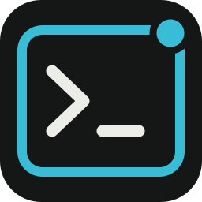
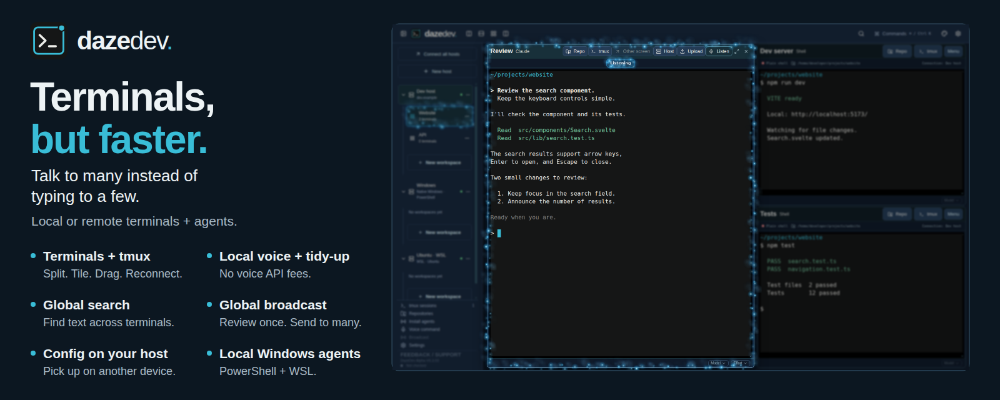

  

<h1 align="center">DazeDev</h1>

**Terminals, but faster.** 
*Talk to many instead of typing to a few.*

I got tired of typing The Lord of the Rings into agents [(seriously, I proved it)](https://github.com/AdamChesters/FrodoTappins-There-And-Backspace-Again), and my fleet of terminal windows was growing, so I made something to organise sessions and speak to them. On-device. For free. It got better and better. Now it’s yours.

## Core features

- **Quick organisation:** split, tile and drag terminals or whole groups between workspaces. Attach to existing tmux sessions.
- **Local voice + tidy-up:** dictate straight into a terminal. Speech recognition and text cleanup run on your machine, with no API fees after downloading the models.
- **Sessions + repos:** one click to see, join, or make tmux sessions. One click to see, select, and auto-prompt your agent to get up to speed with your repo.
- **Global search:** find text across open terminal buffers, or narrow to a host, workspace or terminal.
- **Global broadcast:** review and send one message to selected sessions across hosts and workspaces.
- **Config on your host:** remote workspace layouts and preferences stay on the host. Reconnect from another device to the same setup and tmux sessions.
- **Local Windows agents:** use native PowerShell or WSL, alongside your remote SSH hosts.

## Quality of life

- Persistent PowerShell sessions and detachable windows for extra monitors.
- File uploads, source viewing, Markdown editing and image previews.
- Dictation dictionary, configurable hotkeys and transcript recovery.
- Custom colours, terminal notifications and an optional startup PIN.
- Signed updates that preserve your settings and downloaded models.

## Get started

- [Download the Windows portable ZIP](https://github.com/AdamChesters/DazeDev/releases), extract it and run `DazeDev.exe`.
- Requires Windows x64 and WebView2. WSL and remote Unix hosts also need Python 3 and tmux.
- Keep the adjacent `data/` folder when moving or manually updating the app.

## Coming soon

- **More agents** in the easy-install and new session lists.
- **DIY agent picker:** add your own agent (ASAP).
- **Linux Mint:** a packaged desktop release.
- **Mobile:** an app with on-device voice input.
- **More voice options:** use your frontier plan’s voice models for speed and accuracy (uses your subscription/API).

**macOS and Linux testers wanted.** [Join us on Discord](https://discord.gg/fs4WyaQPA).

In-app feedback goes straight to our Slack. Ask, get.

[User guide](docs/USER-GUIDE.md) · [Updates](apps/desktop/UPDATES.md) · [Banner downloads](docs/media.md)

Support DazeDev

I love making things. Anything I've ever built has been to have fun, share fun, and make life a bit easier. If you got value from one of these things, and you'd like to chuck us a coffee, a bottle, or a god damned Ferrari, go your hardest. Then hustle over to discord to claim your supporter role!

[GitHub Sponsors](https://github.com/sponsors/AdamChesters) · [Buy Me a Coffee](https://buymeacoffee.com/adamch) · [PayPal](https://www.paypal.com/donate/?business=KLHSZPXTSVSAU&no_recurring=0&item_name=I%27ve+donated+to+lots+of+small+creators+for+their+useful+little+tools%2C+now+I+create+them.+Dig+one?+I%27d+love+your+support.&currency_code=AUD)

[Discord](https://discord.gg/fs4WyaQPA) · [AdamCh.com](https://adamch.com) · [More projects](https://github.com/AdamChesters)

Built with Tauri, Svelte, xterm.js and the projects in [Licenses and credits](docs/CREDITS.md). Full [third-party notices](apps/desktop/src-tauri/licenses/) are bundled with the app.
