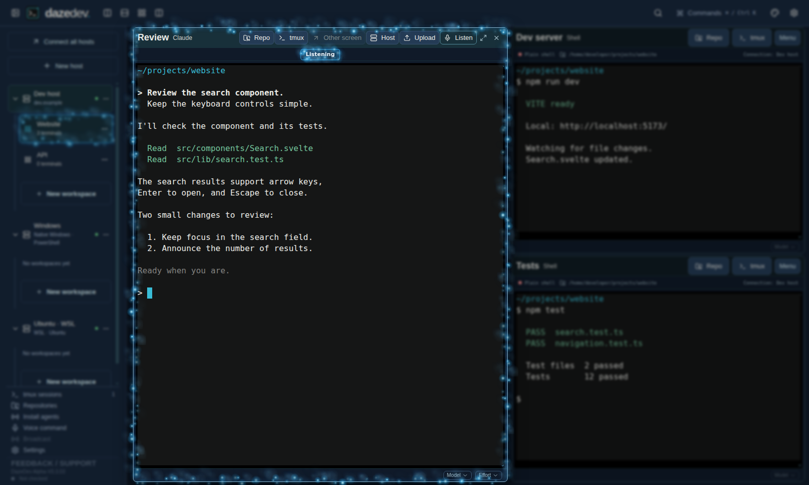
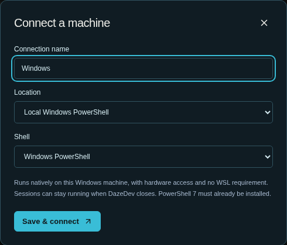
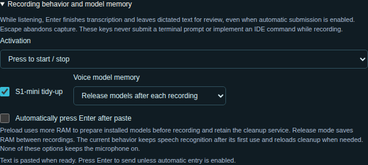
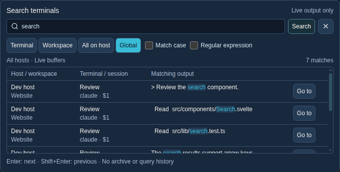
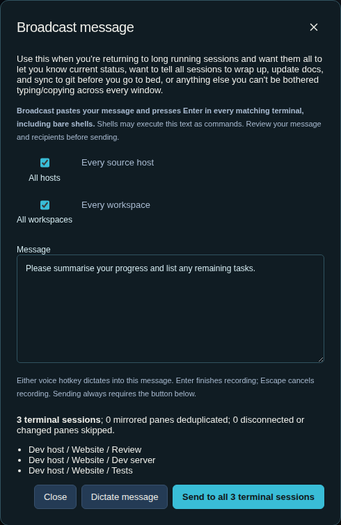
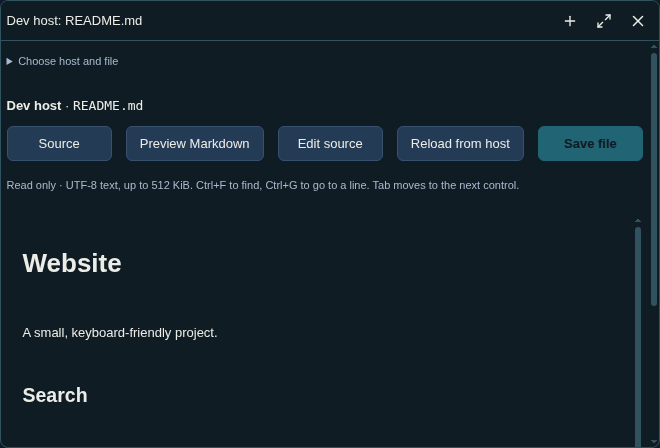

# DazeDev quick guide

Download the [Windows ZIP](https://github.com/AdamChesters/DazeDev/releases), extract it and run `DazeDev.exe`. Requires Windows x64 and WebView2.

Screenshots show the app interface with sample hosts and terminal output.

## Arrange your workspace

- **New workspace:** choose a host, name and terminal count. Use **tmux / Sessions** to join existing sessions.
- **Split** adds a pane; **Balance** tiles them. Drag title bars to rearrange. Shift-click selects a group.
- **Other screen** moves a terminal into its own window.

## Connect a machine

- **New host → Location:** choose PowerShell, WSL or SSH, then **Save & connect**.
- Native PowerShell needs no WSL. WSL and remote Unix hosts need Python 3 and tmux.
- Remote layouts and preferences stay on the host; reconnect from another device to reuse them.

## Dictate, then review

- Install the voice models in **Settings → Voice models**.
- Select a terminal and click **Listen**. **Enter** finishes recording; **Escape** cancels.
- **S1-mini tidy-up** cleans the transcript locally. Voice and tidy-up have no API fees.
- Text is pasted for review; automatic Enter is optional. Configure hotkeys in Settings.

## Search across terminals

- Press **Ctrl+Shift+F**, type your query and select **Global**.
- Narrow to a host, workspace or terminal. **Go to** opens a match.
- Searches open terminal output and scrollback.

## Broadcast a message

- Open **Broadcast** in the sidebar; type or dictate your message.
- Choose the scope, then **Review recipients**.
- **Send** pastes the message **and presses Enter** in each listed session, including bare shells.

## Open files beside your terminals

- Right-click a terminal → **Files and previews**, then enter a path.
- Preview source, Markdown, HTML and images. Use **Edit source → Save file** for Markdown.
- **Upload** transfers local files to the chosen host.

## Keep your setup

- Keep the adjacent `data/` folder when moving or manually updating DazeDev.
- Closing a tmux view leaves the session running. Plain shells may end; PowerShell offers background sessions.

[Update help](../UPDATES.md) · [Build instructions](BUILDING.md) · [Credits](CREDITS.md)
